# Earheart, native

This folder is a port of [Earheart](https://github.com/cleanunicorn/earheart) from [Electron](https://www.electronjs.org/) to one C program. The goal of the fork is to offer the maintainer the same app, behaving the same way at Earheart v0.39.0. Whether to adopt it is his decision; the Electron build in the rest of this repository is untouched.

It runs on Linux (X11), macOS and Windows. Speech-to-text and cleanup use the same engine libraries the Electron build ships, loaded at run time, and the models the Electron build has already downloaded are used where they are.

## Why port it

Earheart waits in the tray all day and is used for a few seconds at a time: a hotkey, some speech, a paste. Its interface is a small overlay and three windows. The Electron build carries a whole browser for that. Idle, with no models loaded, it is seven processes holding 267 MiB, it takes over two seconds to start, and 312 MB of its Linux install is Chromium and Node. The work that makes it useful, turning speech into text and tidying the text, happens in two native libraries that do not need a browser around them.

[gesso](https://github.com/wakamex/gesso) is a small C library on [Simple DirectMedia Layer (SDL)](https://www.libsdl.org/) for apps of this kind. It was built so that a desktop app can be one executable of a few megabytes that builds for Windows, macOS and Linux from one codebase, and it supplies what such an app cannot write for itself on top of SDL: text shaping and system fonts, text fields and a Tab order, HTTPS, JSON, and the desktop services Earheart leans on (global hotkeys, the paste keystroke, the clipboard, notifications, the system's key store). The app draws its own interface with it each frame, so the look of the Electron build could be copied screen by screen. Two apps were released on it before this one, [gtube](https://github.com/wakamex/gtube), a YouTube Music player, and [gstream](https://github.com/wakamex/gstream), a Twitch viewer, which use 22 to 26 MiB.

## Measured against the Electron build

The Electron figures are for the released v0.39.0 packages. The native figures are for an optimised build (`zig build --release=fast`) of this branch. Unless a row names another system, both were measured on the same Linux machine in a virtual display with no models loaded.

### Size

The Electron build's Linux package holds Electron, the app, the speech engine, and llama.cpp three times over: for the CPU, for Vulkan and for NVIDIA's CUDA. The native build holds its executable, the same speech engine, and llama.cpp once, in the build that covers the CPU and Vulkan. It has no installer yet, so its download figure is the executable and engines in a `tar.xz` archive.

| Measure, Linux x64 (smaller is better) | Electron build | Native build |
|---|---|---|
| Download | 390 MB (deb) | 17 MB (archive) |
| Installed | 1,059 MB | 97 MB |
| of which Electron, or the native executable | 312 MB | 4.4 MB |
| of which engine libraries | 740 MB | 93 MB |
| of which CUDA libraries | 508 MB | none |

Dropping CUDA accounts for 508 MB of the 962 MB saved, and it has a cost on NVIDIA cards: the native build reaches them through Vulkan. The macOS package has no CUDA; there the Electron build installs 411 MB, of which Electron is 276 MB.

### Start-up and memory

Memory is proportional set size summed over every process of the app, which counts shared pages once.

| Measure (smaller is better) | Electron build | Native build |
|---|---|---|
| Processes while waiting in the tray | 7 | 1 |
| Memory while waiting in the tray | 267 MiB | 10 MiB |
| Memory with the settings window open | 313 MiB | 147 MiB |
| Time to start the whole app and exit, three runs | 2.26 to 2.29 s | 0.03 to 0.10 s |
| Peak memory of the main process during that start | 182 to 184 MB | 8 to 9 MB |

The native figure with the settings window open is mostly the software OpenGL that a virtual display forces. On the Mac, drawing with Metal, the native build's footprint is 13 MB in the tray and 58 MB with the settings open; the Electron build was not measured there.

With both default models loaded the Electron build totals 3,446 MiB, of which its own processes are 267 MiB and the two engine workers the rest. The native build runs the same engines in the same two workers and was not measured loaded, so the expected saving in a session with models in memory is the 257 MiB between the two tray figures, about 8% of the total.

### Cleanup speed

Cleanup is the step that rewrites a raw transcript into a tidy prompt with a local language model. Both builds were given the same inputs, styles and seeds, 20 cleans per model on the CPU and 5 on the GPU. The table gives median seconds per clean, where lower is better.

| System | Model | Backend | Electron build | Native build |
|---|---|---|---|---|
| macOS | Gemma 3 1B | CPU, 6 threads | 2.40 | 2.36 |
| macOS | Gemma 3 1B | Metal | 1.94 | 1.93 |
| macOS | Qwen3 4B | CPU, 6 threads | 11.89 | 11.50 |
| macOS | Qwen3 4B | Metal | 5.56 | 5.40 |
| Windows | Gemma 3 1B | CPU, 8 threads | 8.42 | 5.21 |
| Windows | Gemma 3 1B | Vulkan | 1.08 | 1.00 |
| Windows | Qwen3 4B | CPU, 8 threads | 32.27 | 27.94 |
| Windows | Qwen3 4B | Vulkan | 1.88 | 1.79 |

The native build is 1% to 7% faster everywhere except the Windows CPU, where it is 13% to 38% faster: llama.cpp's own release picks a CPU backend for the processor at run time, and the Electron build's Windows package has one generic build. With Qwen3 4B, the default model, both builds keep a median 0.94 of the content words and leave no filler words.

### Transcription accuracy

The two builds transcribe equally well, in noise as well as without it. The question arises because Chromium cleans up the microphone before the Electron build sees it (noise suppression, echo cancellation, automatic gain), and the native build records what the microphone delivers. 324 clips of the [FLEURS](https://huggingface.co/datasets/google/fleurs) English test set were played into the Electron build's own overlay as the microphone, and both the audio it captured and the audio as played were transcribed with the same engine. The word error rate (WER, lower is better) was:

| Condition | Electron build | Native build | Native minus Electron in points, with 95% interval |
|---|---|---|---|
| Clip as recorded | 6.36% | 6.27% | -0.08 (-0.68 to 0.41) |
| 20 dB quieter | 6.30% | 6.50% | 0.20 (-0.17 to 0.57) |
| White noise 15 dB below the speech | 8.22% | 8.35% | 0.12 (-0.46 to 0.72) |

Every difference is a fifth of a point or less and every interval includes zero. An earlier run on 40 clips put the native build 2.59 points behind in noise; with eight times the clips that difference is 0.12.

How each figure was taken, with the scripts, is in [decisions.md](decisions.md) under M0, M1, M2 and M5.

## Other differences from the Electron build

- No screen-reader access: gesso draws its own controls and has no accessibility bridge.
- No Updates section and no self-update. Installers and updates wait on the maintainer's signing identity and release feed.
- API keys saved by the Electron build are encrypted for that program alone, so they are entered once more.
- The overlay's keys have no tooltips, and each settings section has a coloured dot where the Electron build has an icon.

The full list, feature by feature, is the parity list in [decisions.md](decisions.md).

## Side by side with the Electron build

Each row shows one screen in the same state in both builds: the Electron build on the left, the native build on the right. Both were drawn on the same Linux machine into a virtual display ([Xvfb](https://www.x.org/releases/current/doc/man/man1/Xvfb.1.xhtml)) at the same size in pixels, so neither has a window frame. The Electron images come from `scripts/screenshots.js` and the native ones from `earheart screenshots DIR`, which fills each window with the same sample content.

| Screen | Electron | Native |
| --- | --- | --- |
| Overlay, recording with live transcript | 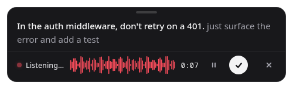 | 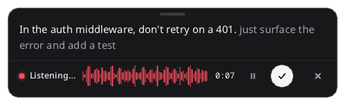 |
| Overlay, saved microphone missing | 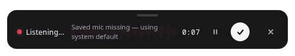 | 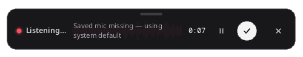 |
| Overlay, paused | 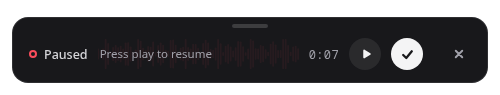 | 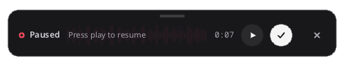 |
| Overlay, cleaning up | 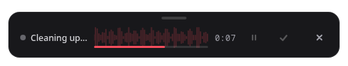 | 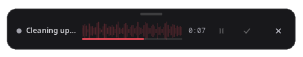 |
| Overlay, pasted | 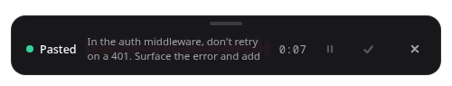 | 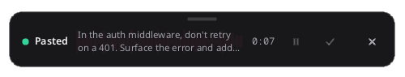 |
| Settings, General | 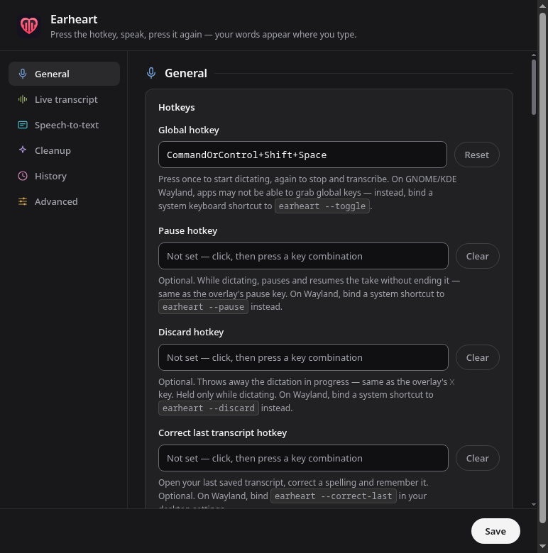 | 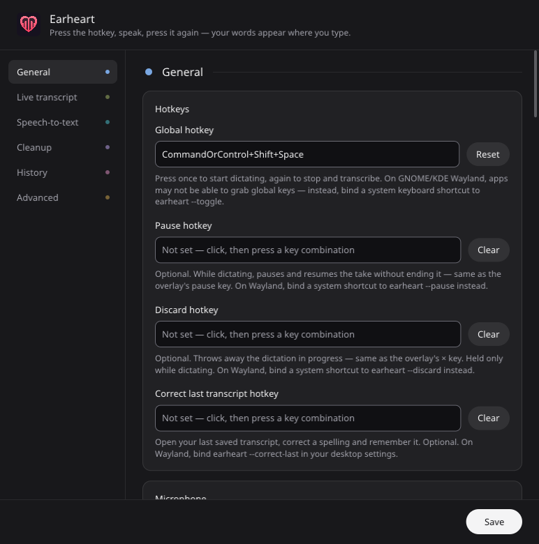 |
| Set-up wizard, first step | 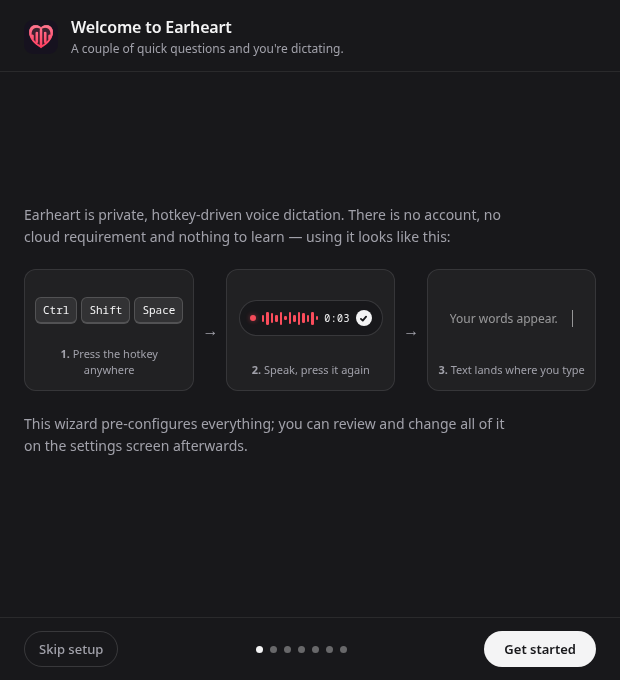 | 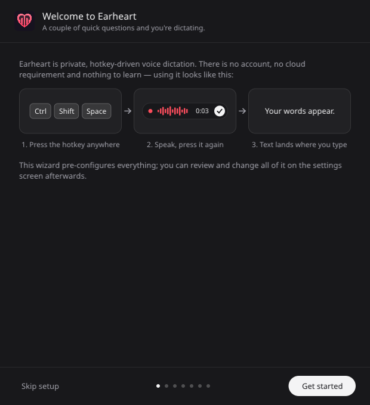 |
| Correct transcript | 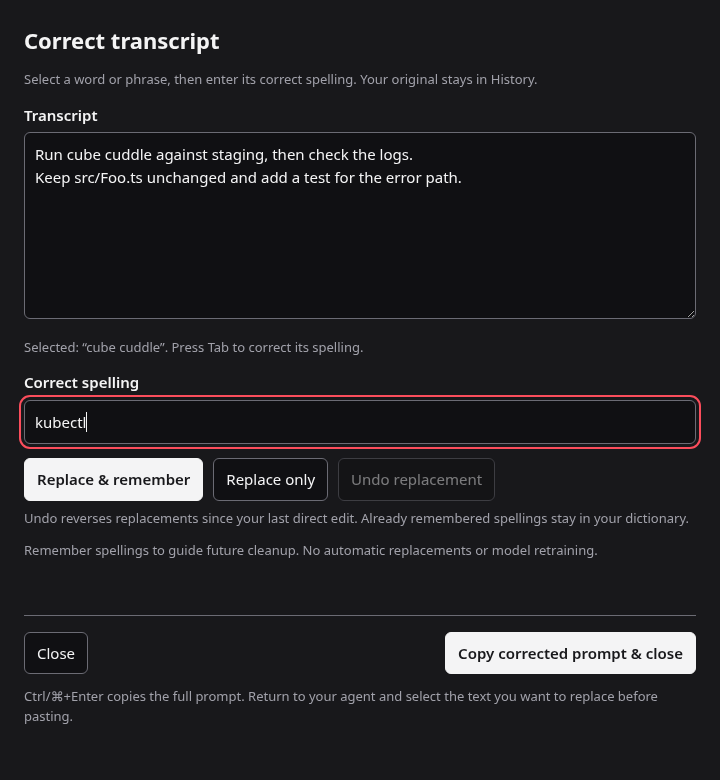 | 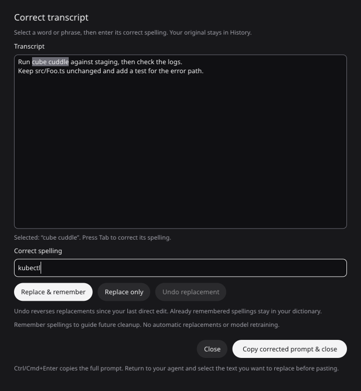 |

The overlay matches closely; the native recording overlay is 2 pixels taller (154 against 152). The framed windows differ in ways the images show:

- Headings and field labels are semibold in the Electron build and regular weight in the native one.
- The wizard's step sits in the middle of the window in the Electron build and at the top in the native one.
- Command names inside the settings hints have a chip behind them in the Electron build and are plain text in the native one.
- In the correction window the native transcript box is taller, the buttons are pills where the Electron build has rounded rectangles, the focused field has a light outline where the Electron build has an accent one, and the selected words stay marked after the keyboard moves to the spelling field.

## Build and test

It needs [Zig](https://ziglang.org/) 0.17.0 and, for the engine libraries, `curl` and `tar`.

```sh
cd native
tools/fetch-engines.sh linux-x64      # or macos-arm64, windows-x64
zig build                              # zig-out/bin/earheart
zig build test                         # the ported logic against the JavaScript it came from
```

The window tests need a display. On Linux without one:

```sh
xvfb-run -a zig-out/bin/earheart settings-smoke tests/vectors/settings.json
xvfb-run -a zig-out/bin/earheart wizard-smoke
xvfb-run -a zig-out/bin/earheart correction-smoke
EARHEART_MODELS=<models folder> xvfb-run -a sh -c 'openbox & sleep 1; tests/e2e.sh'
```

On a Mac, `zig build bundle -Didentity=NAME` makes a signed `zig-out/Earheart.app`. Microphone, Accessibility and notification permissions are filed under the signature, so an ad hoc signature loses them at every build.

## Where things are

- [plan.md](plan.md): the milestones and what each had to pass.
- [decisions.md](decisions.md): every decision taken, the measurements, and the parity list.
- [gesso-requests.txt](gesso-requests.txt): what the port asked of gesso and what came of it.
- `src/`: the app. `tests/`: unit tests and their vectors. `tools/`: vector generators and measurement scripts.
